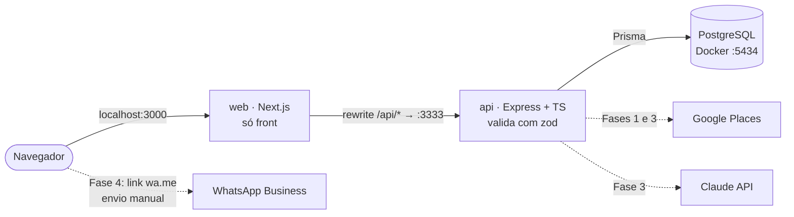

# LOBAE° Prospector

Painel web local para **encontrar pequenos negócios sem site** e fazer o **primeiro contato pelo WhatsApp**, com mensagens personalizadas a partir das avaliações do Google.

> 🚧 Em construção, fase por fase. Veja o [roteiro](#roteiro).

## O problema

Muito negócio de bairro (barbearia, doceria, oficina) tem nota alta e centenas de avaliações no Google, mas nenhum site, ou só um Instagram. Achar esses negócios na mão é lento, e mandar mensagem genérica não funciona.

O Prospector automatiza a parte chata e deixa a parte humana com quem prospecta:

1. **Busca** negócios por segmento + cidade (Google Places).
2. **Filtra** e prioriza quem não tem site ou só tem rede social (nota, nº de avaliações, status).
3. **Monta a mensagem** com os dados do Google, em 3 modelos editáveis (custo zero). Opcional: **qualificar com IA**, que lê as avaliações, dá uma nota e escreve uma mensagem sob medida.
4. **Abre o WhatsApp** com a mensagem pronta e agenda o follow-up. **O envio é manual**, de propósito.
5. **Acompanha o funil** (kanban, follow-ups, notas).

## Demo


_Todos os dados nos prints são fictícios (seed). O GIF do fluxo completo entra na Fase 5._

## Arquitetura



- **`/web`**: Next.js (App Router). Não tem banco nem chaves; só desenha a tela e consome a API com TanStack Query.
- **`/api`**: Express + TypeScript. É o **único** lugar que fala com o banco e com APIs externas, e o único que conhece as chaves.
- **Postgres** roda no Docker; o schema evolui por **migrations versionadas** do Prisma.

## Stack

| Camada | Tecnologias |
| --- | --- |
| Front | Next.js 16, React 19, TypeScript, TanStack Query, CSS Modules, `next/font` (Host Grotesk + Silkscreen) |
| API | Node 22, Express 5, TypeScript, zod, Prisma 7 (driver adapter `pg`) |
| Banco | PostgreSQL 17 (docker-compose) |
| Testes | Vitest (API e web) + Supertest |
| Monorepo | npm workspaces + concurrently |

## Como rodar

**Pré-requisitos:** Node 22+ e Docker Desktop aberto.

```bash
# 1. dependências (instala api e web de uma vez, via workspaces)
npm install

# 2. variáveis de ambiente da API
cp api/.env.example api/.env

# 3. sobe o Postgres e aplica as migrations
npm run db:up
npm run db:migrate

# 4. (opcional) dados fictícios pra ver a tela preenchida
npm run db:seed

# 5. API (:3333) + web (:3000) juntas
npm run dev
```

Abra http://localhost:3000.

### Controle de gastos

O projeto foi pensado para custar quase nada:

| Variável (`api/.env`) | Padrão | Para quê |
| --- | --- | --- |
| `GOOGLE_MONTHLY_CALL_LIMIT` | `200` | Máximo de chamadas pagas ao Google por mês. Depois disso a API recusa com 429. |
| `GOOGLE_MAX_PAGES_PER_SEARCH` | `3` | Teto de páginas por busca (1 página = 1 chamada = até 20 negócios). |
| `GOOGLE_DETAILS_MONTHLY_LIMIT` | `100` | Máximo de buscas de avaliações (Place Details) por mês. É outro tipo de chamada, com cota grátis própria. |
| `ANTHROPIC_MODEL` | `claude-haiku-5-5` | O modelo mais barato do Claude, usado na qualificação. Troque por `claude-sonnet-5-5` se quiser mensagens melhores. |
| `ANTHROPIC_MONTHLY_CALL_LIMIT` | `300` | Máximo de qualificações com IA por mês. |
| `QUALIFY_BATCH_MAX` | `10` | Máximo de leads por "Qualificar selecionados". |

O contador fica no banco (tabela `ApiUsage`) e aparece na tela. Como segunda proteção, vale também definir um **limite de cota diário** para a Places API e um **alerta de orçamento** direto no Google Cloud Console.

### Scripts (na raiz)

| Script | O que faz |
| --- | --- |
| `npm run dev` | sobe API e web juntas, com logs coloridos |
| `npm run db:up` / `db:down` | liga/desliga o Postgres no Docker |
| `npm run db:migrate` | cria/aplica migrations (`prisma migrate dev`) |
| `npm run db:seed` | insere leads fictícios (pode rodar várias vezes, não duplica) |
| `npm test` | testes da API |
| `npm run typecheck` | checa os tipos de API e web |

### Rotas da API

| Rota | Fase | Status |
| --- | --- | --- |
| `GET /health` | 0 | ✅ |
| `GET /leads/stats` | 0 | ✅ |
| `POST /search` | 1 | ✅ |
| `GET /usage` (uso das cotas no mês: busca, avaliações e IA) | 1 | ✅ |
| `GET /leads` (filtros: `websiteType`, `status`, `minRating`, `minReviews`, `q`, `sort`, `page`) | 2 | ✅ |
| `PATCH /leads/:id` (`status`, `notes`, `message`) | 2 | ✅ |
| `POST /leads/:id/qualify`, `POST /leads/qualify` (lote, `{ ids }`) | 3 | ✅ |
| `POST /leads/:id/contacted` (`{ message? }` → ENVIADO, `contactedAt`, follow-up +3 dias) | 4 | ✅ |
| `GET /leads/followups/today` | 5 | ⏳ |

## Estrutura

```
.
├── docker-compose.yml        # Postgres
├── package.json              # workspaces + scripts da raiz
├── api/
│   ├── prisma/
│   │   ├── schema.prisma     # modelo Lead + enums
│   │   ├── migrations/       # histórico versionado do banco
│   │   └── seed.ts           # dados FICTÍCIOS
│   ├── prisma.config.ts      # config da CLI do Prisma 7
│   └── src/
│       ├── app.ts            # monta o Express (testável sem abrir porta)
│       ├── server.ts         # sobe na porta
│       ├── env.ts            # valida variáveis de ambiente com zod
│       ├── lib/              # prisma, regras puras (ex: stats)
│       └── routes/           # health, leads
└── web/
    ├── next.config.ts        # rewrite /api/* → API
    ├── app/                  # layout (cabeçalho), visão geral (/) e leads (/leads)
    ├── components/           # AppHeader, SearchForm, StatusOverview, LeadsTable...
    └── lib/                  # cliente HTTP, tipos, metadados de status
```

## Decisões

**Por que o envio do WhatsApp é manual?**
Automatizar com bibliotecas não oficiais (Baileys, whatsapp-web.js) viola os termos do WhatsApp e é o caminho mais rápido pra ter o número banido. O app faz o trabalho pesado (achar, qualificar, escrever) e entrega um link `wa.me` com a mensagem pronta; quem aperta "enviar" é uma pessoa, no WhatsApp Business. Isso também força uma revisão humana de cada mensagem antes de sair.

**Por que field mask na Google Places API?**
Na Places API (New), o preço de cada chamada depende dos campos pedidos: a requisição é cobrada pela faixa (SKU) do campo mais caro da lista. Sem field mask a API recusa a chamada, e com `*` você paga a faixa máxima por dados que nem usa. Pedir só o que o app precisa (`id`, nome, endereço, telefone, site, nota, nº de avaliações, link do Maps) evita subir de faixa sem necessidade, deixa a resposta menor e documenta no código de quais dados o app depende.

**Por que validar a saída da IA com zod?**
Modelo de linguagem não é contrato: mesmo pedindo JSON, a resposta pode vir com campo faltando, nota fora de 0–100 ou texto onde era número. Validar com zod antes de salvar garante que o banco só recebe dado no formato certo e transforma "a IA respondeu algo estranho" num erro claro, em vez de um bug silencioso na tela.

Na prática são três camadas: (1) **structured outputs** da API do Claude (`messages.parse` + `zodOutputFormat`), que obriga o modelo a responder no formato JSON do schema; (2) o mesmo **schema zod** conferindo a resposta antes do `update` no banco (nota inteira de 0 a 100, textos com tamanho mínimo e máximo); (3) regras que não podem depender da IA "lembrar", como a **assinatura e a linha de saída** da mensagem, são garantidas em código (`ensureSignatureAndOptOut`).

**Como o prompt trata as avaliações?**
As avaliações são texto escrito por terceiros, então vão dentro de tags (`<avaliacoes>`), com `<` e `>` removidos para ninguém "fechar" a tag, e o system prompt manda tratar qualquer instrução lá dentro como texto comum (proteção contra *prompt injection*). O nome de quem escreveu a avaliação **não** é enviado à IA: ela não precisa disso.

**Por que mensagens por modelo, sem IA, por padrão?**
O objetivo era custo zero. Os dados que já vêm do Google (nome, nota, nº de avaliações, se tem site ou só Instagram, segmento e cidade) bastam para uma mensagem específica e honesta. São 3 modelos (Direta, Elogio + pergunta, Curta), funções puras em `web/lib/messageTemplates.ts`, com testes. Você escolhe um, edita à vontade e envia. A IA continua no projeto como opção: sem `ANTHROPIC_API_KEY`, a tela esconde tudo que depende dela.

**Por que "Abrir no WhatsApp" é um link (`<a>`) e não `window.open`?**
Navegadores bloqueiam janelas abertas por código depois de uma requisição assíncrona. Um link de verdade, clicado pela pessoa, nunca é bloqueado. O mesmo clique dispara o `POST /leads/:id/contacted` em paralelo, que marca o lead como ENVIADO e agenda o follow-up. O telefone é normalizado para o formato `55 + DDD + número` (`web/lib/phone.ts`), e números que não parecem válidos desativam o botão em vez de abrir uma conversa errada.

**Por que o Haiku com esforço baixo?**
Qualificar um negócio é uma tarefa curta e bem definida. O modelo mais barato (`claude-haiku-5-5`) com `effort: "low"` custa uma fração de centavo por lead. O modelo fica no `.env` (`ANTHROPIC_MODEL`) para trocar sem mexer no código. Antes de chamar a IA, a API confere se a chave existe: sem chave, nenhuma cota é gasta.

**Por que os filtros da tabela passam pela API (e não filtram no navegador)?**
Com centenas de leads, mandar tudo para o navegador e filtrar lá fica pesado. A API valida os filtros com zod, o Postgres filtra, ordena e pagina, e só 25 leads viajam por vez. No front, cada combinação de filtros vira uma chave de cache do TanStack Query, e a busca por nome espera você parar de digitar (debounce) antes de chamar a API.

**Por que contar as chamadas ao Google no banco?**
Um limite só na memória zera toda vez que a API reinicia (e em dev ela reinicia a cada arquivo salvo). No banco, o contador sobrevive. A "reserva" de uma chamada é um único `UPDATE ... WHERE calls < limite`: o próprio Postgres confere e soma no mesmo passo, então nem duas buscas simultâneas furam o limite. A chamada é contada **antes** de ir ao Google; se o Google falhar, ela continua contada (melhor errar para menos).

**Por que, por padrão, a busca não salva quem já tem site?**
O foco do Prospector é quem **não tem site** ou tem **só rede social** (Instagram, Linktree, wa.me...). O Google não deixa filtrar isso na busca e cobra a chamada igual, então o filtro acontece depois de classificar e antes de salvar: o resumo mostra quantos tinham site, mas eles não entram no funil. Dá para desmarcar a opção no formulário (`skipRealSites: false`).

**Por que o upsert não mexe em status e notas?**
Buscar "barbearia em Mogi" de novo atualiza só os dados que vêm do Google (telefone, nota, site...). Status do funil, notas e mensagem são trabalho seu e nunca são sobrescritos por uma busca repetida.

**Por que validar também a resposta do Google com zod?**
Pelo mesmo motivo da IA: é um dado que vem de fora. Se o formato mudar, o erro aparece na hora com uma mensagem clara, em vez de salvar lixo no banco.

**Por que o front chama `/api/*` e o Next repassa (rewrite)?**
O navegador só enxerga uma origem (`localhost:3000`), então não precisa configurar CORS. E as chaves nunca chegam ao front: o `web` não tem `.env` com segredo nenhum.

**Por que migrations versionadas?**
Cada mudança no schema vira um arquivo SQL commitado. Qualquer pessoa (ou eu daqui a seis meses) reconstrói o banco exatamente igual com `npm run db:migrate`, e dá pra ver no histórico do git quando e por que uma coluna surgiu.

**Por que `createApp()` separado de `server.ts`?**
Os testes de rota usam o Supertest direto no app, sem abrir porta, e trocam o Prisma por um dublê. Assim testam o contrato HTTP (status e formato do JSON) em milissegundos, sem precisar de banco.

**Por que `API_PORT` e não `PORT`?**
`PORT` costuma já vir definido no ambiente (launchers, plataformas de deploy) e o Node dá prioridade a ele sobre o `.env`. Na prática isso fez a API subir na porta 3000 e "roubar" a porta do Next. Um nome específico evita a colisão.

**Por que dados fictícios no seed?**
O repositório e os prints são públicos. Os leads de demo usam nomes inventados, DDD `00` (que não existe) e domínios `example.com`/`example.org` (reservados pra exemplo). Leads reais só existem no banco local.

## Testes

```bash
npm test
```

- **Unitários:** regras puras: contadores por status e classificação de `websiteType` (Instagram, Linktree, wa.me... = `social`). No front (Vitest no `web`): normalização de telefone brasileiro para o `wa.me` e os 3 modelos de mensagem.
- **Rotas (Supertest):** status HTTP e formato do JSON de cada rota, com o Prisma e o Google substituídos por dublês. A busca é testada com paginação, lugares repetidos, limite de páginas, cota esgotada e erro do Google; a qualificação, com resposta inválida da IA, cota esgotada, chave faltando e lote com falha parcial. Nada disso gasta chamada de verdade.

## Roteiro

- [x] **Fase 0, Esqueleto:** monorepo, Postgres, schema + migration, `/health`, `/leads/stats`, tela com contadores
- [x] **Fase 1, Buscar:** segmento + cidade → Google Places, upsert por `placeId`, classificação do site, limite mensal de chamadas
- [x] **Fase 2, Filtrar:** tabela com filtros, ordenação, paginação e troca de status (PageSpeed ficou de fora: o foco é quem não tem site)
- [x] **Fase 3, Qualificar (opcional):** avaliações → Claude (Haiku) → nota, gancho e mensagem, validados com zod; individual ou em lote, com cota mensal
- [x] **Fase 4, Contatar:** 3 modelos de mensagem editáveis (sem IA), "Abrir no WhatsApp" com telefone normalizado, ENVIADO + follow-up em 3 dias
- [ ] **Fase 5, Funil:** kanban, follow-ups do dia, notas
